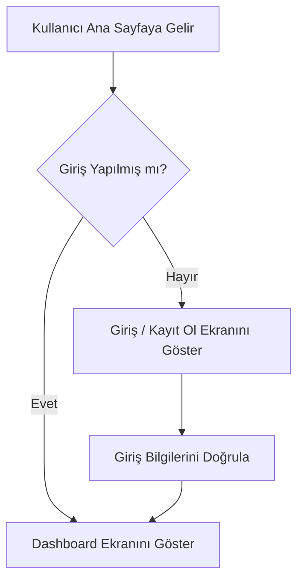

markdown
# 📋 Proje Adı: [Buraya Projenin Adını Yazın]
> **Proje Rolü:** İş Analisti & UX/UI Tasarımcısı  
> **Durum:** 🚀 Yapım Aşamasında / Tamamlandı

Bu depo, projenin **İş Analizi Dokümantasyonunu (FRD)**, kullanıcı senaryolarını ve **UX/UI / GUI tasarım süreçlerini** içermektedir. Canlı arayüz önizlemesine yukarıdaki GitHub Pages linkinden ulaşabilirsiniz.

---

## 🎯 1. Proje Özeti ve Kapsamı
[Bu projenin amacı nedir? Hangi problemi çözüyor? Kısa bir paragraf ile açıklayın.]

### Temel Hedefler:
*   Hedef 1 (Örn: Kullanıcı kayıt süresini %40 hızlandırmak)
*   Hedef 2 (Örn: Mobil uyumlu, minimalist bir GUI sunmak)

---

## 👥 2. Kullanıcı Personaları & Hedef Kitle
*   **Persona A (Son Kullanıcı):** [Örn: Ahmet, 25 yaşında, teknoloji meraklısı, hızlı işlem yapmak istiyor.]
*   **Persona B (Yönetici/Admin):** [Örn: Ayşe, 40 yaşında, detaylı raporlama ve kullanıcı yönetimi paneline ihtiyaç duyuyor.]

---

## 📝 3. Kullanıcı Hikayeleri (User Stories)
Bir İş Analisti olarak sistemin gereksinimlerini aşağıdaki formatta takip ediyorum:

1.  **Giriş İşlemleri:** "Bir **Kullanıcı** olarak, şifremi unuttuğumda hesabımı kurtarabilmek için **Şifremi Unuttum** bağlantısına tıklayabilmek istiyorum."
2.  **Profil Yönetimi:** "Bir **Kullanıcı** olarak, bilgilerimi güncel tutabilmek için **Profilimi Düzenle** sayfasına erişebilmek istiyorum."

---

## ⚙️ 4. Fonksiyonel Gereksinimler (Functional Requirements)
*   **FR-01:** Sistem, kullanıcının şifresini en az 8 karakter ve en az 1 sayı içerecek şekilde doğrulamalıdır.
*   **FR-02:** GUI tasarımı, tüm mobil cihazlar ve tabletlerle tam uyumlu (responsive) olmalıdır.

---

## 🎨 5. UX/UI & GUI Tasarım Süreci
Tasarım prototipleri ve görsel hiyerarşi süreçleri aşağıda listelenmiştir:

*   **Renk Paleti:** `#PrimaryColor` (Ana Renk), `#SecondaryColor` (Yardımcı Renk)
*   **Tipografi:** Inter / Roboto (Temiz ve okunabilir modern sans-serif fontlar)
*   **Figma Canlı Prototip Linki:** [Buraya Figma linkinizi yapıştırın]

---

## 🗺️ 6. İş Akış Diyagramı (User Flow)
*Aşağıdaki diyagram GitHub tarafından otomatik olarak görsel bir akış şemasına dönüştürülecektir:*

